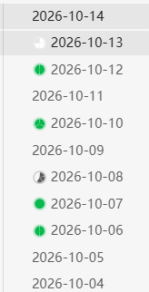

# Task Progress

Show a task progress ring next to every note in Obsidian's file explorer — one segment per task, filled in as you complete them.

在 Obsidian 的文件栏里，给每个笔记显示一个待办进度圈：**一个待办占一格，完成一个填一格。**



Notes with no tasks show no ring. A ring stays grey until every task in that note is done, then turns green.

## What it counts

For each markdown file, in this order:

1. **Inline checkboxes** — every `- [ ]` / `- [x]` in the note. `x` and `X` count as done; everything else (` `, `/`, `-`, `>`) counts as not done.
2. **The note itself as a to-do** — if there are no inline checkboxes but the front matter has `todo: true`, the note gets a single-segment ring. Set `completed: true` and the ring fills in.
3. **Nothing** — notes with no tasks show no ring at all.

Rule 2 exists for vaults that keep one to-do per file (a folder of small notes rather than a checklist inside one note).

## Details

- The ring is drawn clockwise from 12 o'clock, with a hairline gap between segments so a 13-segment ring is still countable.
- Hover a ring to see `done/total` as a tooltip.
- Updates live as you edit, and follows the file explorer through folding, renaming and scrolling.
- Works on desktop and mobile.

## Install

Search for **Task Progress** in Settings → Community plugins → Browse.

Or install it by hand:

1. Download `main.js`, `manifest.json` and `styles.css` from the [latest release](https://github.com/14790897/task-progress/releases/latest).
2. Put them in `<your vault>/.obsidian/plugins/task-progress/`.
3. Reload Obsidian, then enable **Task Progress** in Settings → Community plugins.

## Notes and limitations

- Completion is read from Obsidian's metadata cache, so the plugin does not touch your notes — it is read-only.
- A note that has *both* inline checkboxes and `todo: true` is counted by its checkboxes. A note like "things to buy" with a real checklist inside is a checklist, not a single to-do.
- Tasks inside code blocks are not counted, because Obsidian's own parser does not treat them as list items.
- Folder-level totals are not shown yet.

## Development

```bash
npm install
npm run dev     # watch mode
npm run build   # type-check and produce main.js
```

## License

MIT
